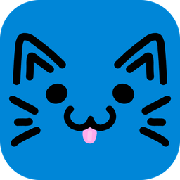
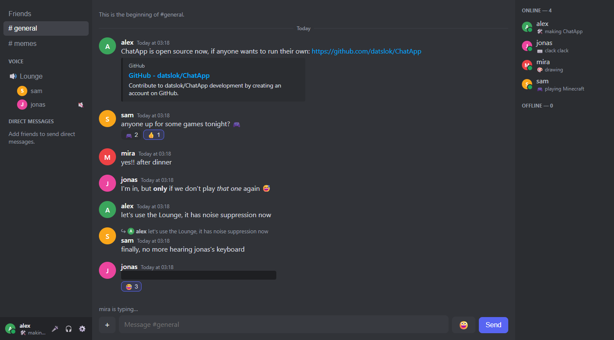

<p align="center"></p>

# ChatApp

**ChatApp is a lightweight chat app, inspired by Discord, that you can host yourself.** Text
channels and DMs, voice and video calls, screen sharing, and a Windows app, for a group of friends
(it's made for about 5–20 people), running on an ordinary PC at home.

The original runs at https://chat.datslok.no for a group of friends. It started as a learning project,
and is still small and readable on purpose: a Python server split into small modules by topic, plain
HTML, CSS and JavaScript for the page, no frameworks.



## Features

- **Messages:** text channels and direct messages, replies, reactions (every emoji, plus 24 custom
  emoji per person, animated too), @mentions and @everyone, editing and deleting, formatting
  (`**bold**`, `*italic*`, `` `code` ``, code blocks, quotes, `||spoilers||`), link previews,
  pictures and files (drag, drop or paste), GIF search (GIPHY), unread dots, and history that loads
  as you scroll up.
- **People:** accounts by invite link (each one works once), with verified emails, friends and friend requests, profiles (picture, banner,
  status, bio; GIFs too), who's online and who's typing, admins who can tidy up.
- **Voice and video:** a voice channel everyone can join and calls in DMs, with cameras, AI noise
  suppression (RNNoise, or DeepFilterNet 3 on PCs), a noise gate and a volume per person. **Screen sharing** up to 1440p at
  60 fps with sound, encoded on the graphics card where possible.
- **Notifications** for DMs and mentions, with sounds and muting. Clicking one goes to the message.
- **A Windows app and an Android app** (both optional) with real notifications and automatic updates.
  Everything also works in the browser, and on iPhones it installs as an app of its own (a PWA).
- **For the people running it:** a "What's new" page you write yourself, bug reports and ideas sent
  to the admins, nightly backups, and one-command updates.

## How it's built

| Part | What |
|------|------|
| Server | Python: [FastAPI](https://fastapi.tiangolo.com/) with WebSockets: `server.py` and the modules in `chatapp/`. SQLite for the data. |
| Page | Plain HTML, CSS and JavaScript (`static/`), no framework and no build step. |
| Voice, video, screen sharing | A self-hosted [LiveKit](https://livekit.io/) server (WebRTC). |
| Reaching it from the internet | A [Cloudflare Tunnel](https://developers.cloudflare.com/cloudflare-one/connections/connect-networks/), so no ports need opening for the chat itself. |
| Desktop app | [Tauri](https://tauri.app/) (`desktop/`): a small window around the site. |
| AI bot (optional) | Chattus (`chattus.py`), an account that talks over the same WebSocket, with a language model on the server's graphics card ([llama.cpp](https://github.com/ggml-org/llama.cpp)), or Claude through Anthropic's API. |
| Phone app | [React Native](https://reactnative.dev/) with [Expo](https://expo.dev/) (`mobile/`), for Android. On other phones the site installs as a PWA. |

**Windows only, for now.** The server itself is plain Python, but the scripts that install and run it
are PowerShell scripts for Windows 10/11. Linux support is planned for later.

## Try it on your own PC

You need [Git](https://git-scm.com/) and [Anaconda](https://www.anaconda.com/) or Miniconda (for
Python). In PowerShell:

```powershell
git clone https://github.com/datslok/ChatApp.git
cd ChatApp
Set-ExecutionPolicy -Scope CurrentUser RemoteSigned   # once: lets PowerShell run scripts you have locally
.\setup.ps1          # makes the "chatapp" conda environment and installs the packages
.\start.ps1          # the chat, on http://localhost:8001, restarting when you change the code (Ctrl+C stops it)
```

Open http://localhost:8001, click **Create one**, and make an account (no invite link is needed
here: `dev.env` has `REQUIRE_INVITE=0`). There's no mail server either, so the email with the link that
verifies your address is printed in the server window instead: open that link to get in. Open a
second browser window (a private one, so it has its own login) to make a second account and chat
between them. This uses its own database (`dev.db`) and upload folder (`dev-uploads/`), set in
`dev.env`.

GIF search, videos, voice and making admins in development: see [More for trying it on your PC](docs/guides/development.md#more-for-trying-it-on-your-pc).

## Documentation

The guides, in [docs/guides/](docs/guides/):

- [Host your own](docs/guides/hosting.md): from nothing to your own chat on the internet, with the optional
  landing page, GIF search and seasonal easter egg
- [The AI bot](docs/guides/ai-bot.md) (optional): Chattus, on your own graphics card or through Claude
- [Running it](docs/guides/running.md): updating, What's new, handy commands, backups, moving to another PC
- [Scripts at a glance](docs/guides/scripts.md): every script and tool, where it runs and what it does
- [The phone app](docs/guides/phone-app.md): installing the chat on a phone, and the native Android app
- [The desktop app](docs/guides/desktop-app.md) (optional): the Windows app, releasing it, its icon
- [Working on the code](docs/guides/development.md): how the code is laid out, and the tests

How things work inside, part by part, is in [docs/notes/](docs/notes/) (the developer notes).

## Credits

The app icons (the cats) are made by Niamh Hannon.

## License

The code is under the [MIT license](LICENSE): use it, change it and run your own copy. The cat icon
isn't: it belongs to Niamh Hannon, so a copy of your own should use its own icon. LiveKit's browser
library, the RNNoise files and DeepFilterNet's files keep their own licenses (see [LICENSE](LICENSE)).
