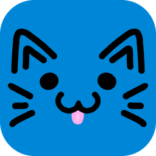
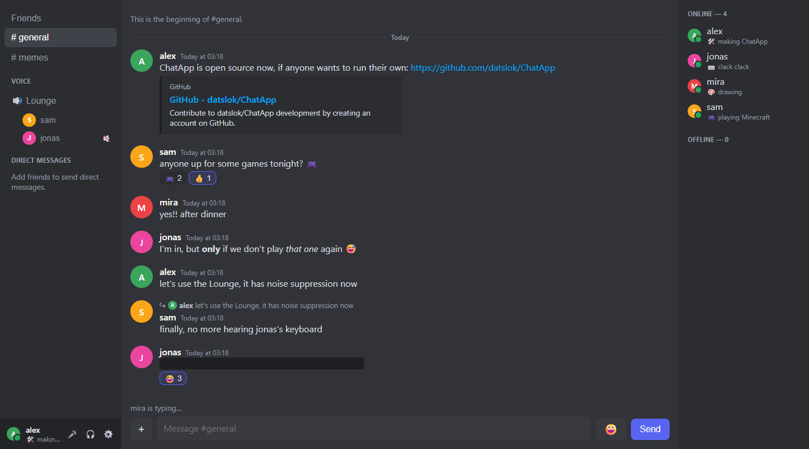

<p align="center"></p>

# ChatApp

**ChatApp is a lightweight chat app, inspired by Discord, that you can host yourself.** Text
channels and DMs, voice and video calls, screen sharing, and a Windows app, for a group of friends
(it's made for about 5–20 people), running on an ordinary PC at home.

The original runs at https://chat.datslok.no for a group of friends. It started as a learning project,
and is still small and readable on purpose: one Python file for the server, plain HTML, CSS and
JavaScript for the page, no frameworks.



## Features

- **Messages:** text channels and direct messages, replies, reactions (every emoji, plus 12 custom
  emoji per person, animated too), @mentions and @everyone, editing and deleting, formatting
  (`**bold**`, `*italic*`, `` `code` ``, code blocks, quotes, `||spoilers||`), link previews,
  pictures and files (drag, drop or paste), unread dots, and history that loads as you scroll up.
- **People:** accounts with an invite code, friends and friend requests, profiles (picture, banner,
  status, bio; GIFs too), who's online and who's typing, admins who can tidy up.
- **Voice and video:** a voice channel everyone can join and calls in DMs, with cameras, AI noise
  suppression (RNNoise), a noise gate and a volume per person. **Screen sharing** up to 1440p at
  60 fps with sound, encoded on the graphics card where possible.
- **Notifications** for DMs and mentions, with sounds and muting. Clicking one goes to the message.
- **A Windows app** (optional) with real Windows notifications and automatic updates. Everything also
  works in the browser, and on phones it installs as an app of its own (a PWA).
- **For the people running it:** a "What's new" page you write yourself, bug reports and ideas sent
  to the admins, nightly backups, and one-command updates.

## How it's built

| Part | What |
|------|------|
| Server | Python: [FastAPI](https://fastapi.tiangolo.com/) with WebSockets, all in `server.py`. SQLite for the data. |
| Page | Plain HTML, CSS and JavaScript (`static/`), no framework and no build step. |
| Voice, video, screen sharing | A self-hosted [LiveKit](https://livekit.io/) server (WebRTC). |
| Reaching it from the internet | A [Cloudflare Tunnel](https://developers.cloudflare.com/cloudflare-one/connections/connect-networks/), so no ports need opening for the chat itself. |
| Desktop app | [Tauri](https://tauri.app/) (`desktop/`): a small window around the site. |

**Windows only, for now.** The server itself is plain Python, but the scripts that install and run it
are PowerShell scripts for Windows 10/11. Linux support is planned for later.

---

## Contents

- [Try it on your own PC](#try-it-on-your-own-pc) (10 minutes)
- [Host your own](#host-your-own): from nothing to your own chat on the internet
- [Running it](#running-it): updating, What's new, handy commands, backups, moving to another PC, a shared window going black
- [The phone app](#the-phone-app): installing the chat on a phone
- [The desktop app](#the-desktop-app) (optional)
- [Working on the code](#working-on-the-code)
- [Credits](#credits) and [License](#license)

## Scripts at a glance

Run them in PowerShell, from the project folder. Each one also explains itself in comments at its top.
"Your PC" is where you work on the code; "the server" is the PC that runs the real chat (they can be
the same PC, but the scripts assume two).

| Script | Where | What it does |
|--------|-------|--------------|
| `setup.ps1` | your PC | makes a conda environment and installs the Python packages |
| `start.ps1` | your PC | the chat for trying and developing (http://localhost:8001, its own `dev.db`) |
| `voice.ps1 -Dev` | your PC | voice for development (only reachable from this PC) |
| `scripts\server\install.ps1` | server (as admin) | installs and sets up everything; safe to run again |
| `serve.ps1`, `voice.ps1` | server | the chat and voice; scheduled tasks start them at boot |
| `scripts\server\update.ps1` | server (as admin) | gets the newest code and restarts the chat |
| `scripts\server\backup.ps1` | server | the nightly backup (also by hand) |
| `scripts\server\usage.ps1` | server | how much space everything takes (only reads) |
| `scripts\server\export.ps1` / `import.ps1` | old / new server | pack and unpack the data, to move the server |
| `scripts\server-connect.ps1` | your PC | once: SSH access to the server, named `chatserver` |
| `scripts\deploy.ps1` | your PC | pushes your code and runs `update.ps1` on the server (`-Voice`: also restarts voice) |
| `scripts\usage.ps1` | your PC | runs `usage.ps1` on the server |
| `scripts\backup-fetch.ps1` | your PC | copies the server's newest backup here (`-Install`: every day) |
| `scripts\release-upload.ps1` | your PC | puts a new desktop app version on the server |
| `scripts\refresh-icons.bat` | any Windows PC | double-click: Windows shows programs' new icons (after a new app icon) |
| `tools\make_admin.py` | either | make someone an admin, or take it away |
| `tools\feedback.py` | either | read the bug reports and ideas, mark them done |
| `tools\make_pwa_icons.py` | your PC | makes the phone app's icons from the app icon |

---

## Try it on your own PC

You need [Git](https://git-scm.com/) and [Anaconda](https://www.anaconda.com/) or Miniconda (for
Python). In PowerShell:

```powershell
git clone https://github.com/datslok/ChatApp.git
cd ChatApp
Set-ExecutionPolicy -Scope CurrentUser RemoteSigned   # once: lets PowerShell run scripts you have locally
.\setup.ps1          # makes the "chatapp" conda environment and installs the packages
.\start.ps1          # the chat, on http://localhost:8001, restarting when you change the code (Ctrl+C stops it)
```

Open http://localhost:8001, click **Create one**, and make an account (no invite code is needed
here). Open a second browser window (a private one, so it has its own login) to make a second account
and chat between them. This uses its own database (`dev.db`) and upload folder (`dev-uploads/`), set in
`dev.env`.

To make your account an admin: `python tools\make_admin.py yourname --db dev.db` (with the `chatapp`
environment active: `conda activate chatapp`).

**Voice and video** need LiveKit's server program: download `livekit_<version>_windows_amd64.zip`
from [LiveKit's releases](https://github.com/livekit/livekit/releases) (the version in
`scripts\server\install.ps1`, `$LiveKitVersion`), and put `livekit-server.exe` in a `livekit\` folder
here. Then, in a second PowerShell window: `.\voice.ps1 -Dev`.

---

## Host your own

What you'll end up with: your chat at `https://chat.<your domain>`, running on a PC at home,
starting by itself when that PC starts, with voice and video, nightly backups, and updates with one
command.

### What you need

- **A Windows 10 or 11 PC that's always on.** An old laptop is plenty for a group of friends: any
  4-core CPU, 4–8 GB of memory, an SSD, and **a network cable** (not Wi-Fi, for voice). A second disk
  (or a USB disk that stays plugged in) for the nightly backups is recommended.
- **A domain name, with its DNS on Cloudflare** (the free plan is enough). The chat will live at a
  subdomain like `chat.example.com`, and voice at `voice.example.com`.
- **Access to your router's settings**, to forward two ports for voice. Without that, everything
  except voice, video and screen sharing still works.
- **Optional: an email service with SMTP** (Resend, Brevo, Mailgun, or your own email provider), for
  "forgot password" emails and bug reports to admins. Without it, emails are only written to the log.

In the steps below, replace `example.com` with your domain.

### 1. Cloudflare: a tunnel with two addresses

The tunnel is a program (`cloudflared`) on your server that keeps a connection open to Cloudflare.
Visitors go to Cloudflare, and Cloudflare passes them through that connection, so the chat is
reachable without opening ports for it, and you get HTTPS for free.

1. Add your domain to [Cloudflare](https://dash.cloudflare.com/) if it isn't there yet (Cloudflare
   explains how to point your domain's nameservers to it).
2. In the [Zero Trust dashboard](https://one.dash.cloudflare.com/): **Networks → Tunnels → Create a
   tunnel**, choose **Cloudflared**, and give it a name (like `chatapp`).
3. It shows an install command with a long **token** starting with `eyJ`. Copy just the token and
   keep it for step 4 (it's a password: don't share it).
4. Add two **public hostnames** (also called published application routes) to the tunnel:

   | Hostname | Service |
   |----------|---------|
   | `chat.example.com` | `HTTP` → `localhost:8000` |
   | `voice.example.com` | `HTTP` → `localhost:7880` |

   Cloudflare makes the DNS records for them by itself.

### 2. The server: get the code

On the server PC, open PowerShell and install Git with Windows' own installer:

```powershell
winget install --exact --id Git.Git
# close PowerShell and open it again, so it finds git
cd C:\
git clone https://github.com/datslok/ChatApp.git    # or your own fork
cd C:\ChatApp
Set-ExecutionPolicy -Scope CurrentUser RemoteSigned
```

`C:\ChatApp` is where the scripts on your other PC expect it (`$ServerFolder` in `scripts\deploy.ps1`
and `scripts\usage.ps1`). Somewhere else works too, if you change those two lines.

If you keep your fork **private**, the server needs a way in that works without anyone logged in:
make an SSH key on the server (`ssh-keygen -t ed25519 -f "$HOME\.ssh\github_chatapp" -N '""'`), add
its `.pub` file on GitHub as a **deploy key** (the repository → Settings → Deploy keys, read-only),
point `github.com` at that key in `$HOME\.ssh\config`, and clone with `git@github.com:you/ChatApp.git`.

### 3. The server: settings (`.env`)

```powershell
Copy-Item .env.example .env
notepad .env
```

Every setting is explained in the file. The ones to change:

| Setting | What to put |
|---------|-------------|
| `INVITE_CODE` | The code people need to create an account. Something hard to guess. |
| `PUBLIC_URL` | `https://chat.example.com` |
| `LIVEKIT_URL` | `wss://voice.example.com` |
| `LIVEKIT_API_SECRET` | A long random secret (see below). |
| `SMTP_*`, `MAIL_FROM` | Your email service's details, or leave `SMTP_HOST` empty. |

A random secret, made by PowerShell itself:

```powershell
$bytes = New-Object byte[] 32; [Security.Cryptography.RandomNumberGenerator]::Create().GetBytes($bytes); [Convert]::ToBase64String($bytes)
```

`.env` holds your secrets: it's in `.gitignore`, so it never ends up on GitHub.

### 4. The server: install everything

Open PowerShell **as administrator** (right-click it, "Run as administrator"), then:

```powershell
cd C:\ChatApp
.\scripts\server\install.ps1
```

It installs Python (with the packages, in `.venv`), LiveKit and `cloudflared`, adds firewall rules for
voice, sets the power options (never sleep while plugged in; closing the lid does nothing), switches
on Windows' SSH server (only reachable from your home network, for updating from your other PC), and
makes scheduled tasks that start the chat and voice at boot (and again within 5 minutes if they ever
stop). It asks for:

- **The tunnel's token** from step 1.
- **Your Windows password**, so the tasks can start at boot before anyone logs in. With a Microsoft
  account, that's the account's password, not the PIN.
- **The backup disk's drive letter** (Enter for `E`). The backups go into `ChatApp-backups` there,
  every night at 04:00. No second disk? Type a letter that doesn't exist to skip it for now.

At the end it starts the chat and voice and checks they answer. It's safe to run again (for example
after changing your answers); every step checks what's already done.

### 5. The router: two ports for voice

The tunnel carries the chat, but not voice's audio and video (they use UDP, which the tunnel can't
carry). So your router has to send two ports straight to the server:

1. Find the server's local address: `ipconfig` in PowerShell, "IPv4 Address" (like `192.168.1.50`).
   The router's address is the "Default Gateway" on the same screen: open it in a browser.
2. In the router's **port forwarding** settings, forward to the server's address:
   - **UDP 7882** (the normal way for audio and video)
   - **TCP 7881** (the fallback, for networks that block UDP)
3. Give the server a **DHCP reservation** in the router, so its address never changes.

### 6. Your account, and making yourself admin

Open `https://chat.example.com`, click **Create one**, and make your account with the invite code.
Then, on the server, make yourself an admin (admins can edit and delete anyone's messages and
custom emoji, and read the bug reports):

```powershell
cd C:\ChatApp
.venv\Scripts\python.exe tools\make_admin.py yourname
```

### 7. Check

- `https://chat.example.com` works, and you can make an account and chat.
- Voice: join the **Lounge** with someone (or from your phone, off Wi-Fi) and hear each other. In
  `logs\voice.log` near the top, LiveKit should say *"using external IPs"* with your public address.
  If it says *"could not validate external IP"*, the router's forwarding isn't right yet.
- Restart the server without logging in, and wait a minute: the chat should come back by itself.

Then share the address and the invite code with your friends.

**Make it your own:** the channels are a list at the top of `server.py` (`CHANNELS = ["general",
"memes"]`) and the voice channel is `VOICE_ROOMS`; change them and update (see below). The "What's
new" page is yours to write (see [What's new](#whats-new)), and the icon should be your own too (see
[License](#license)).

### Optional: a landing page

`static/landing/` is a page about ChatApp (what it is, a screenshot, the features, and buttons to the
chat, the Windows app and creating an account). It's always at `https://chat.example.com/welcome`. To
show it on your main domain (`https://example.com`) instead:

1. In `.env`: `LANDING_HOST=example.com`, then restart the chat (`Stop-ScheduledTask ChatApp;
   Start-ScheduledTask ChatApp`).
2. In the Zero Trust dashboard, add a third public hostname to your tunnel: `example.com` →
   `HTTP` → `localhost:8000` (the same as the chat: the server looks at which address was asked for).
   If Cloudflare says a DNS record for it already exists, delete that record first (and any Redirect
   Rule for it, under your domain → Rules).

The page's buttons lead to your `PUBLIC_URL` by themselves. Someone logged in to the chat sees their
name and **Log out** at the top (the page asks the chat's `/whoami`, which only answers your
`LANDING_HOST`; this needs the main domain and the chat to be the same site, like `example.com` and
`chat.example.com`). Its texts and pictures (`logo.png`,
`screenshot.png`) are yours to change.

### 8. Optional: update from your other PC

So you can work on the code on your own PC and update the server without walking over to it. Step 4
printed a line for this at its end; run it here, in the project folder:

```powershell
.\scripts\server-connect.ps1 192.168.1.50 yourname    # the server's address and your Windows username there
```

It makes an SSH key on this PC (if you don't have one), puts it on the server (asking for your
password there once), and names the server **chatserver**: after that, `ssh chatserver` logs in
without a password, and `scripts\deploy.ps1` works.

---

## Running it

### Updating

From your own PC, after committing your changes:

```powershell
.\scripts\deploy.ps1          # pushes to GitHub if needed, then updates the server and restarts the chat
.\scripts\deploy.ps1 -Voice   # also restart LiveKit (after changing voice.ps1 or livekit.yaml); ends ongoing calls
```

Or on the server itself (PowerShell as administrator, in `C:\ChatApp`): `.\scripts\server\update.ps1`.
Both fetch the newest code from GitHub, install any new packages and restart the chat. Calls carry on
(unless you restart voice too).

Open pages and apps reload themselves within a few seconds after an update that changed the page:
nobody needs to press F5. Someone in a call, with files waiting to be sent, or editing a message gets
the new version once they're done; a half-typed message is kept.

If your internet provider changes your home's public IP address, restart voice
(`.\scripts\deploy.ps1 -Voice`, or restart the server): LiveKit looks up the address when it starts.

### What's new

Settings → **What's new** shows `static/changelog.json`, which you write by hand, in two parts:
`changes` (what changed when, newest day first) and `features` (an overview of everything the chat can
do, by topic). Both are short lines for the people using it, and can use the chat's formatting
(`**bold**`, `` `code` `` and so on). Any change to `changes` (a new line, or an edited one) puts a red
dot on everyone's ⚙️ until they've opened the page.

```json
{
  "features": [
    {"topic": "💬 Messages", "items": ["Enter sends, Shift+Enter starts a new line", "..."]}
  ],
  "changes": [
    {"date": "2026-10-13", "items": ["Something new", "And something else"]},
    {"date": "2026-10-12", "items": ["..."]}
  ]
}
```

The file in this repository describes the original's history: for your own chat, you may want to
start `changes` from scratch.

### Handy commands (on the server)

From your PC, `ssh chatserver` gives you a PowerShell on the server; then `cd C:\ChatApp`. Or sit at
the server itself, in PowerShell as administrator.

```powershell
# Admins.
.venv\Scripts\python.exe tools\make_admin.py --list              # who's an admin?
.venv\Scripts\python.exe tools\make_admin.py alex                # make alex an admin
.venv\Scripts\python.exe tools\make_admin.py alex --remove       # take it away again

# Bug reports and ideas (Settings → Bugs & ideas). Each one is also emailed to every admin with an
# email address. Admins can read them and tick them off in the chat too: Settings → Inbox.
.venv\Scripts\python.exe tools\feedback.py                       # the ones not done yet
.venv\Scripts\python.exe tools\feedback.py --done 12             # tick off #12 (--undo 12: back again)
.venv\Scripts\python.exe tools\feedback.py --all                 # every one, done ones too

# Is everything running? (ChatApp and ChatApp voice: Running. ChatApp backup: Ready.)
Get-ScheduledTask ChatApp*

# The logs. chat.log: starts and errors; chat.out.log: every request; voice.log: LiveKit.
Get-Content logs\chat.log -Tail 30
Get-Content logs\chat.log -Tail 30 -Wait                         # keep following it (Ctrl+C stops)
Get-Content logs\backup.log -Tail 5

# Restart by hand (update.ps1 does this too).
Stop-ScheduledTask ChatApp; Start-ScheduledTask ChatApp
Stop-ScheduledTask "ChatApp voice"; Start-ScheduledTask "ChatApp voice"

# The tasks start again by themselves within 5 minutes when they aren't running. To keep one off
# for a while, disable it, and enable it again afterwards:
Disable-ScheduledTask "ChatApp voice"; Stop-ScheduledTask "ChatApp voice"
Enable-ScheduledTask "ChatApp voice"

# What Task Scheduler did (started, stopped, failed), newest first. Also in taskschd.msc, History.
Get-WinEvent Microsoft-Windows-TaskScheduler/Operational -MaxEvents 20 | Format-Table TimeCreated, Message -Wrap

# A backup now, besides the nightly one.
.\scripts\server\backup.ps1 -Destination E:\ChatApp-backups

# How much space everything takes, and how much is free (only reads).
.\scripts\server\usage.ps1
```

(Stopping a task can leave its program running; if a restart doesn't seem to take, use
`.\scripts\server\update.ps1`, which also ends those.) On your own PC, `tools\make_admin.py` and
`tools\feedback.py` work the same with `--db dev.db`, for the development chat.

### Backups

Every night at 04:00 the server backs itself up onto its backup disk (`E:\ChatApp-backups` by default;
the scheduled task **ChatApp backup**):

- `2026-10-11\chat.db` and `.env`: a safe copy of the database (and the settings) per day, the last 30 kept
- `uploads\` and `releases\`: every file, new ones added each night, nothing deleted

Your own PC can fetch the newest one too, so there's a copy outside the server:

```powershell
.\scripts\backup-fetch.ps1 -Install    # a daily task (05:00, or as soon as this PC is on)
.\scripts\backup-fetch.ps1             # fetch now
```

That copy goes into `~\ChatApp-backups` (your user folder). Logs: `logs\backup.log` on the server,
`~\ChatApp-backups\fetch.log` on your PC.

**Restoring** (on the server, PowerShell as administrator, in `C:\ChatApp`):

```powershell
Stop-ScheduledTask ChatApp                               # stop the chat (voice can keep running)
Copy-Item E:\ChatApp-backups\2026-10-11\chat.db chat.db  # the day to go back to
robocopy E:\ChatApp-backups\uploads uploads /E           # brings back missing uploads
Start-ScheduledTask ChatApp
```

Everything after that day's 04:00 is lost (messages, accounts, settings changed since).

### Moving to another PC

1. **On the old server:** `.\scripts\server\export.ps1` makes `chatapp-data.zip` with `chat.db` (a safe
   copy, even while the chat runs), `uploads\`, `releases\` and `.env`. Copy it to a USB stick. **It
   holds your secrets and everyone's messages**: delete it everywhere once the move is done.
2. **On the new PC:** steps 2 and 4 of [Host your own](#host-your-own), but instead of writing `.env`
   (step 3), unpack the data before installing: `.\scripts\server\import.ps1 D:\chatapp-data.zip`.
   For the tunnel's token, use the same tunnel: in the Zero Trust dashboard, your tunnel → **Add a
   connector** (or Configure) shows it.
3. **On the old server**, as administrator: `cloudflared service uninstall` (otherwise the tunnel sends
   some visitors to the old PC), and stop its scheduled tasks.
4. **The router:** change the two port forwardings to the new PC's address, and give it a DHCP reservation.
5. **On your PC:** `.\scripts\server-connect.ps1` with the new address, then check as in step 7.

### A shared window goes black

Sharing a single browser window (say, YouTube in Chrome) and then covering it with another window
makes the share go black, and it comes back as soon as a bit of the window shows again. That's the
browser, not the chat: Chrome and Edge stop drawing a window that's completely covered, to save
power, without knowing that another program is capturing it. Ways around it, for whoever shares:

- Share the **entire screen** instead of the window (the others then see whatever is on top).
- Keep the shared window uncovered, for example on a second screen.
- Start Chrome or Edge with `--disable-features=CalculateNativeWinOcclusion` (right-click its
  shortcut, Properties, add it to the end of Target after a space; close every window of it first).

---

## The phone app

The chat installs on phones as a **PWA** ("progressive web app"): its own icon on the home screen and
its own window without the browser's address bar, straight from the website, with no app store. It's
the same page as in the browser, so it's always up to date. What makes it installable:
`static/manifest.json` (its name, icons and colours), the icons in `static/icons/` (made by
`python tools\make_pwa_icons.py` from the app icon) and a service worker, `static/sw.js`.

To install it: open the chat in **Chrome on Android**, ⋮ menu, **Install app** (or "Add to Home
screen"). On an **iPhone**: Safari, the Share button, **Add to Home Screen**.

If the microphone or camera "isn't allowed" although the site allows it, Android may be blocking the
browser itself: Settings, Apps, Chrome (and the installed ChatApp), Permissions, Microphone and Camera.

Calls keep going with the screen off on most Android phones. If a call stops when the phone is in a
pocket, set the browser's battery use to "Unrestricted" in Android's app settings. iPhones often stop
web pages when they're locked, calls included.

---

## The desktop app

Optional: everything works in the browser. The Windows app (`desktop\`, made with
[Tauri](https://tauri.app/)) is a small window around your site, with real Windows notifications,
links opening in the default browser, and automatic updates. Changes to the chat reach it through the
site; a new app version is only needed when the app itself changes (its Rust code, plugins, the icon).
People download it from `https://chat.example.com/download`.

Building it needs [Node.js](https://nodejs.org/) and [Rust](https://rustup.rs/). In `desktop\`,
`npm install` once, then `npm run tauri dev` opens the app straight from the code.

### Making it yours

The app in this repository points at the original chat and is signed with its key. For your own:

1. **Your address**, in three places: `desktop\src-tauri\tauri.conf.json` (`app.windows[0].url`, and
   `plugins.updater.endpoints`: `https://chat.example.com/releases/latest.json`) and
   `desktop\src-tauri\capabilities\default.json` (`remote.urls`: `https://chat.example.com/*`).
2. **Your own app id**: `identifier` in `tauri.conf.json` (like `com.example.chat`), so it doesn't
   collide with the original's app on someone's PC.
3. **Your own signing key.** Updates are only installed if they're signed with the key the app was
   built with. Make one (press Enter twice when it asks for a password, for none), and put the
   **public** key it prints in `tauri.conf.json` (`plugins.updater.pubkey`):
   ```powershell
   npm run tauri signer generate -- -w "$HOME\.tauri\chatapp.key"
   ```
   Keep the private key safe and never commit it: without it, installed apps can't update any more,
   and everyone would have to reinstall by hand.
4. **Your own icon** (see [Changing the icon](#changing-the-icon)).

### Releasing a version

Everyone's app installs a new version by itself (open apps when they reconnect after the server
restarts, or after their call; the others at their next start).

1. Raise `"version"` in `desktop\src-tauri\tauri.conf.json` (like 0.1.8 → 0.1.9).
2. Build and sign it, in `desktop\`:
   ```powershell
   $env:TAURI_SIGNING_PRIVATE_KEY = "$HOME\.tauri\chatapp.key"
   $env:TAURI_SIGNING_PRIVATE_KEY_PASSWORD = ""
   npm run tauri build
   ```
3. Copy `ChatApp_<version>_x64-setup.exe` and its `.sig` from
   `desktop\src-tauri\target\release\bundle\nsis\` into `releases\` (in the project folder).
4. Write `releases\latest.json` (what the apps and the download page read):
   ```json
   {
     "version": "0.1.9",
     "platforms": {
       "windows-x86_64": {
         "url": "https://chat.example.com/releases/ChatApp_0.1.9_x64-setup.exe",
         "signature": "the whole contents of the .sig file"
       }
     }
   }
   ```
5. Commit the version change, then put it on the server:
   ```powershell
   git add desktop; git commit -m "Desktop app 0.1.9: ..."
   .\scripts\release-upload.ps1
   ```
   It copies the installer and `latest.json` into the server's `releases\`, deletes the older versions
   there and in your own `releases\` (the apps only ever update upwards; the nightly backup keeps every
   version), and then runs `deploy.ps1`, whose restart makes open apps look for the new version.

**Testing the update window** (what people see while the app updates): in `desktop\`, make a file
`pretend.json` containing `{"version": "0.1.0"}`, then `npm run tauri dev -- --config pretend.json`.
The app then believes it's old, finds the live version, and updates to it.

### Changing the icon

Put the new picture (a 1024×1024 PNG) in `icon\`, then in `desktop\`:
`npm run tauri icon ../icon/<file>.png` (delete the `android`, `ios`, `Square*`/`StoreLogo` and
`icon.icns` files it also makes), copy `desktop\src-tauri\icons\icon.ico` to `static\favicon.ico`
(the browser tab's icon; also raise the number in the pages' `favicon.ico?v=` links, so browsers fetch
the new one instead of keeping the old one for a day), point `tools\make_installer_images.py` at the
new file (its `ICON` line), run `python tools\make_installer_images.py` (the installer's pictures and the
update window's cat), and release a new version. The phone app's icons: `python tools\make_pwa_icons.py`
(it reads the same `ICON` file name; change it there too).

### The old icon is still showing after an update

Windows keeps a cache of every icon it has shown, and doesn't always notice when a program's icon
changes: the taskbar, Start menu or desktop can keep showing the old one after the app has updated.
**`scripts\refresh-icons.bat`** fixes that: double-click it. It stops Explorer (the taskbar and desktop
disappear for a moment; nothing else closes), deletes the icon cache, and starts Explorer again, which
then reads every icon fresh. If a program pinned to the taskbar still shows its old icon, unpin it and
pin it again.

It's a plain `.bat` file, so you can send it to the people using your chat (in the chat itself, for
example) and they can run it with a double-click. Downloaded files make Windows ask first: choose
**Run** (or **More info → Run anyway**).

---

## Working on the code

- `server.py`: the whole server: accounts, messages, channels, uploads, link previews, voice tickets,
  the WebSocket. Sections are marked with `# ---------- Name ----------` comments.
- `static/index.html`, `static/css/chat.css` and `static/js/`: the chat page. The scripts are plain
  scripts sharing one global scope, loaded in the order listed in `index.html`.
- `static/login.html`, `reset.html`, `download.html`: the other pages.
- `livekit.yaml`: LiveKit's settings. `desktop/`: the Windows app. `tools/`: small helper programs.
- [ROADMAP.md](ROADMAP.md): what's done and what's planned.

The code is written to be read: comments explain the *why*, and there are no build steps. Develop
with `start.ps1` (it restarts when you save), and try things in two browser windows.

**CLAUDE.md** is the original author's instruction file for [Claude Code](https://claude.com/claude-code),
the AI assistant this project was built with: how they like to work (small steps, explained first)
and notes about their setup. If you use Claude Code with your copy and want a different workflow,
write your own `CLAUDE.md`.

## Credits

The app icons (the cats) are made by Niamh Hannon.

## License

The code is under the [MIT license](LICENSE): use it, change it and run your own copy. The cat icon
isn't: it belongs to Niamh Hannon, so a copy of your own should use its own icon. LiveKit's browser
library and the RNNoise files keep their own licenses (see [LICENSE](LICENSE)).
